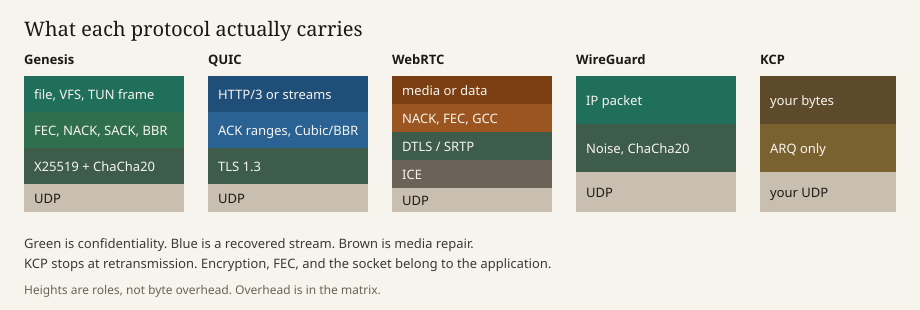
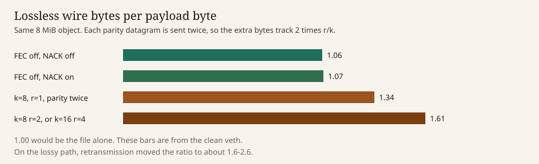
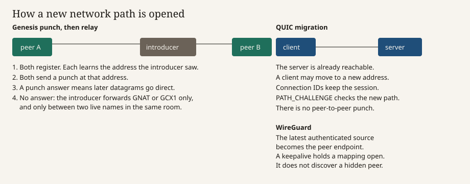
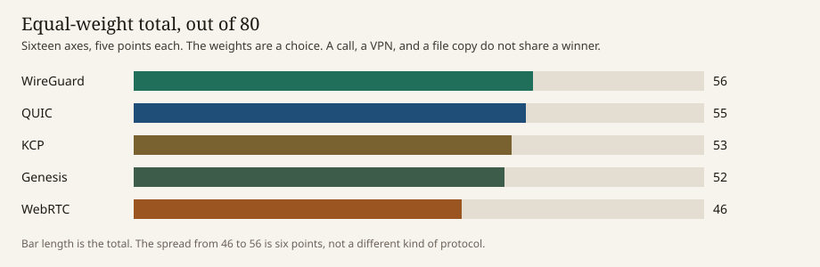

# Genesis compared with QUIC, WebRTC, WireGuard, and KCP

Compared on 15 Nov 2026. Genesis is the C++20 tree in this repository (protocol version in the GCX1 header). The other four are judged from their specifications and from the implementations people actually ship. Only Genesis and a plain TCP stream were timed on the lab path below. A QUIC, WebRTC, WireGuard, or KCP number in the score table is a reading of that design, and the cell says so.

Equal weights are a choice. They are not a property of the protocols. On that choice the totals sit in a band of ten points out of eighty: WireGuard 56, QUIC 55, KCP 53, Genesis 52, WebRTC 46. A video call, a VPN, and a file copy pick different winners inside that band.

## What each one is for

| Protocol | Job it is built for | What this comparison used |
| --- | --- | --- |
| Genesis | One file, a directory mount, or a TUN/TAP frame, over UDP, with its own handshake | This tree, release build, measured below |
| QUIC | Many reliable streams on UDP, with TLS 1.3. HTTP/3 is the common application | RFC 9000, RFC 9001, RFC 9002. Not timed here |
| WebRTC | Real-time media and data channels between browsers and apps | ICE (RFC 8445), DTLS-SRTP, NACK (RFC 4585), ULPFEC (RFC 5109), FlexFEC (RFC 8627). Not timed here |
| WireGuard | An IP tunnel with a small handshake | WireGuard whitepaper and protocol description. Noise analysis in eprint 2018/080. Not timed here |
| KCP | A reliable ARQ layer you put on your own UDP socket | `ikcp.c` and the project README. Not timed here |
| TCP | The bulk ceiling on the same wires | Python sockets, no TLS, timed on the veth only |

TCP is a ruler for the veth. It is not a sixth product column in the score table.

## Conditions of the timing

The timed object is 8 MiB of random bytes (`8388608`). Genesis finishes a receive when every offset is present and the SHA-256 in the FIN matches. Every Genesis row below matched the same digest prefix `ef323b866b23`. The TCP row counts bytes the receiver read.

Two places:

- Loopback, `127.0.0.1`, on the build machine. That process sees the machine's default route. The route is a Wi-Fi name (`wlan0`), so an automatic profile turns FEC on.
- A veth pair in two network namespaces, `10.99.1.1/30` and `10.99.1.2/30`. The interfaces are named `vA` and `vB`. Those names classify as unknown. On a sub-millisecond RTT the engine then behaves like Ethernet: NACK on, FEC left off unless the command asks for it. The namespaces and the veth were removed after the runs.

Three veth schedules, applied with `tc netem` on both ends:

| Name | Each direction | Round trip, if both ends add |
| --- | --- | --- |
| clean | no qdisc | the veth's own delay |
| rtt40 | `delay 20ms` | about 40 ms, no loss |
| loss | `delay 20ms loss 1%` | about 40 ms, and a datagram can die on the way out or on the way back |

Genesis commands used the release `genesis` binary. The window stays at the default 512. `plain_mss` stays at the profile default (1200, or 1336 if the command selects the Ethernet profile). Cases:

| Case | Flags |
| --- | --- |
| default | none |
| fec-off-nack-off | `--fec off --nack off --profile gbe` |
| fec-on-r1-nack-on | `--fec on --nack on --profile wifi --fec-k 8 --fec-r 1` |
| fec-on-r2-nack-on | same with `--fec-r 2` |
| fec-on-r2-nack-off | `--fec on --nack off --profile wifi --fec-k 8 --fec-r 2` |
| fec-on-r4-nack-on | `--fec on --nack on --profile wifi --fec-k 16 --fec-r 4` |
| fec-off-nack-on | `--fec off --nack on --profile wifi` |

`k=16, r=4` has the same parity-to-data ratio as `k=8, r=2`. It is a larger group, not more redundancy. The engine sends each parity datagram twice and does not retransmit parity (`src/core/engine.cpp`). The lossless wire ratio therefore follows about `1.06 × (1 + 2·r/k)`.

The clock is wall time from process start until the sender exits and, for TCP, until the receiver has every byte. The CLI field `rate=` is payload bytes per second on the engine clock (the function is named `rate_bps` and returns bytes). That number excludes process start, so it sits above the wall-clock goodput. The tables use the wall clock. Goodput in Mbit/s is `8388608 × 8 / seconds / 10⁶`.

Lossless rows are one sample. An earlier pass over the same loopback cases landed within about ten percent. The loss rows are three samples, because the first sample was not a stable rate.

QUIC was not started. The machine's `curl` can speak HTTP/3, and there was no HTTP/3 server on this veth to aim it at. A public QUIC download uses a different path and is not a row in this matrix. The October bulk figures in [LIVE_TRANSFER.md](LIVE_TRANSFER.md) are a different day, a different window, and a Wi-Fi or routed path. They are summarized later and are not mixed into these rates.

## Rates

### Loopback, automatic profile is Wi-Fi

| Case | Seconds | Payload | Wire / payload |
| --- | ---: | ---: | ---: |
| default (FEC on, r=1) | 0.94 | 71 Mbit/s | 1.34 |
| FEC off, NACK off | 0.63 | 106 Mbit/s | 1.06 |
| FEC off, NACK on | 0.59 | 113 Mbit/s | 1.07 |
| k=8, r=1, NACK on | 0.71 | 95 Mbit/s | 1.34 |
| k=8, r=2, NACK on | 0.82 | 82 Mbit/s | 1.61 |
| k=8, r=2, NACK off | 0.78 | 86 Mbit/s | 1.61 |
| k=16, r=4, NACK on | 0.90 | 75 Mbit/s | 1.61 |

Turning FEC on for a lossless loopback costs throughput. The default is the slow one here because the default route is Wi-Fi.

### Clean veth

Plain TCP moved the 8 MiB in 0.091 s, about 740 Mbit/s. That is a veth, so the ceiling is memory, not a NIC.

| Case | Seconds | Payload | Wire / payload |
| --- | ---: | ---: | ---: |
| TCP | 0.091 | 740 Mbit/s | 1.00 of the file |
| default (FEC off) | 0.60 | 112 Mbit/s | 1.07 |
| FEC off, NACK off | 0.60 | 113 Mbit/s | 1.06 |
| FEC off, NACK on | 0.59 | 114 Mbit/s | 1.07 |
| k=8, r=1, NACK on | 0.69 | 98 Mbit/s | 1.34 |
| k=8, r=2, NACK on | 0.79 | 85 Mbit/s | 1.61 |
| k=8, r=2, NACK off | 0.77 | 87 Mbit/s | 1.61 |
| k=16, r=4, NACK on | 0.79 | 85 Mbit/s | 1.61 |

Genesis on this clean veth is real and is well under the TCP ceiling: about 110 Mbit/s against about 740 Mbit/s. Header, AEAD, userspace, and the pacer account for that gap. NACK adds almost no wire when nothing is lost (1.07 against 1.06).

### Forty-millisecond veth, no loss

| Case | Seconds | Payload | Wire / payload |
| --- | ---: | ---: | ---: |
| TCP | 1.19 | 56 Mbit/s | 1.00 |
| default | 0.92 | 73 Mbit/s | 1.07 |
| FEC off, NACK off | 0.88 | 77 Mbit/s | 1.06 |
| FEC off, NACK on | 0.93 | 72 Mbit/s | 1.07 |
| k=8, r=1, NACK on | 1.00 | 67 Mbit/s | 1.34 |
| k=8, r=2, NACK on | 1.09 | 61 Mbit/s | 1.61 |
| k=8, r=2, NACK off | 1.09 | 62 Mbit/s | 1.61 |
| k=16, r=4, NACK on | 1.18 | 57 Mbit/s | 1.61 |

On a short lossless transfer, TCP is still opening its window. Genesis starts from a pace and finishes this 8 MiB sooner. That is a statement about an 8 MiB object at 40 ms, not a statement that Genesis outruns TCP on a long flow.

### Forty milliseconds and 1% loss each way

Three samples. The same command can finish in about a second or in half a minute. A single sample would have ranked the protocols by luck.

| Sample | TCP | Genesis default | r=1, NACK | r=2, NACK | k=16 r=4, NACK |
| --- | ---: | ---: | ---: | ---: | ---: |
| 1 | 17.0 s, 4.0 Mbit/s | 1.8 s, 37 Mbit/s | 3.2 s, 21 Mbit/s | 1.3 s, 51 Mbit/s | 23.7 s, 2.8 Mbit/s |
| 2 | 0.99 s, 68 Mbit/s | 34.8 s, 1.9 Mbit/s | 3.6 s, 19 Mbit/s | 18.7 s, 3.6 Mbit/s | 6.5 s, 10 Mbit/s |
| 3 | 1.47 s, 46 Mbit/s | 4.0 s, 17 Mbit/s | 3.7 s, 18 Mbit/s | 1.5 s, 46 Mbit/s | 5.7 s, 12 Mbit/s |

Every Genesis sample still matched the file hash. TCP delivered the byte count on every sample. The spread is the result:

- `r=1` was the steady one, about 18–21 Mbit/s, and it was never the fastest.
- `r=2` produced the two fastest Genesis samples and one 19-second sample.
- `k=16, r=4` produced no fast sample. Same redundancy ratio, larger group, worse day.
- TCP's three samples were 4, 46, and 68 Mbit/s. The slow TCP sample is not "TCP under 1% loss." The fast ones are not a QUIC result either.

Wire/payload on these loss samples sat between about 1.6 and 2.6. Retransmission, not the FEC formula, dominated the extra bytes. NACK-off still retransmits on the timeout. On this path, explicit NACKs did not produce a cleaner rate than the timeout.

## Other Genesis observations, other conditions

These are not rows in the matrix. They are earlier measurements of this protocol, with hostnames and paths left out. Details are in [LIVE_TRANSFER.md](LIVE_TRANSFER.md) and [NAT.md](NAT.md).

October 2026, release build, window cut to 48 on Wi-Fi because the full window stalled. Goodput there is the engine's payload bytes per second.

| Path | Payload | Goodput | Wire |
| --- | ---: | ---: | ---: |
| Loopback | 32 MiB | 16 MB/s | 40 MB |
| Loopback through a 10% drop proxy | 32 MiB | 17 MB/s | 49 MB |
| Laptop to a LAN peer | 32 MiB | 0.42 MB/s | 86 MB |
| LAN peer back to the laptop | 32 MiB | 4.1 MB/s | 45 MB |
| Routed peer to the laptop | 308 MiB | 0.95 MB/s | 627 MB |
| Laptop to the routed peer, cellular profile, window 32 | 308 MiB | 0.60 MB/s | 695 MB |

A raw UDP blast of 1200-byte datagrams on that laptop-to-LAN hop was about 1.0 MB/s. The file transfer in that direction was slower than the blast and used far more wire. The reverse direction was faster. The cellular profile was used on the return of the large object because an automatic full-window attempt climbed and then stopped.

A later NAT exercise, again a different path, with several NATs between the peers:

| Mode | What moved | Result |
| --- | --- | --- |
| Relayed datagrams | 4 MiB | 12.0 s, 2.8 Mbit/s, RTT average 165 ms |
| Direct punch on a private route | 4 MiB | 11.7 s, 2.9 Mbit/s, RTT average 111 ms |
| Same LAN, direct | 4 MiB | 59.5 Mbit/s, RTT average 2.6 ms |
| Directory read over the relay | 256 KiB | about 38 kbit/s, checksum matched |
| TUN over the relay | ping, then 2 MiB of TCP | ping 0% loss; TCP 3.4 Mbit/s |

The directory mount is stop-and-wait and paced. It is a correct copy, and it is a poor way to move bulk data. The TUN path carried a short TCP flow at a few megabits per second on a relay whose RTT was about a tenth of a second.

## Axis by axis

Scores run from 1 to 5. Five is better for the person who has to ship that axis. A 5 on simplicity means a smaller, easier protocol, not a larger one.

### Implementation simplicity

| Genesis | QUIC | WebRTC | WireGuard | KCP |
| ---: | ---: | ---: | ---: | ---: |
| 3 | 2 | 1 | 4 | 5 |

This tree is about 6,100 lines in `src/core` and `include/genesis`, 4,500 in `src/posix`, and 1,600 in the apps, plus a 17-line embedded entropy stub. One reader can walk the core. The core still includes a handshake, Reed-Solomon, a pacer, gossip, a DHT, and the NAT messages.

KCP's `ikcp.c` is on the order of a thousand lines. It does ARQ. The caller supplies the clock, the UDP socket, and any encryption. WireGuard's stated implementation is under 4,000 lines and the packet formats are short. QUIC is a large RFC plus a TLS 1.3 stack; the usual advice is to adopt ngtcp2, quiche, msquic, quinn, or picoquic rather than write one. WebRTC's commonly linked library is a browser media stack.

### Robustness

| Genesis | QUIC | WebRTC | WireGuard | KCP |
| ---: | ---: | ---: | ---: | ---: |
| 3 | 5 | 4 | 4 | 3 |

QUIC names packets so a retransmission cannot be confused with the original, acknowledges ranges, and has a published recovery RFC. It has years of independent implementations. WebRTC repairs media with NACK and FEC and estimates congestion in the receiver. WireGuard keeps a small state machine and drops anything that fails authentication; loss repair belongs to whatever runs inside the tunnel. KCP retransmits selectively and can send more than the path can absorb.

Genesis has a cumulative ack, a SACK bitmap, NACKs, a timeout that doubles up to one second, FEC that can fill a hole before the timeout, and a file hash that must match. The loss table is the limit on the score: the same settings sometimes stall for tens of seconds, and a larger FEC group made that worse. One implementation exists. The address format used for NAT is IPv4.

### Features

| Genesis | QUIC | WebRTC | WireGuard | KCP |
| ---: | ---: | ---: | ---: | ---: |
| 4 | 4 | 5 | 2 | 2 |

WebRTC carries audio, video, and data channels, with ICE, TURN, simulcast, and the repair codecs above. QUIC carries many streams, optional 0-RTT with replay limits, connection migration, HTTP/3, and UDP proxying through MASQUE (RFC 9298).

Genesis carries a resumed file with a SHA-256, a directory export and a FUSE mount, a TUN/TAP device, encrypted gossip, a small DHT, and an introducer that punches or relays. It does not carry independent streams, a browser API, or a standard congestion-control profile other stacks already implement.

WireGuard carries IP packets and routes by public key. That narrowness is the design. KCP carries a reliable byte flow or messages. Encryption, FEC, and NAT are outside the core; a few language ports add FEC beside it.

### Transfer rate, default configuration, clean path

| Genesis | QUIC | WebRTC | WireGuard | KCP |
| ---: | ---: | ---: | ---: | ---: |
| 3 | 4 | 2 | 5 | 4 |

Measured: Genesis default on the clean veth was 112 Mbit/s of payload, and TCP on that veth was about 740 Mbit/s. The Wi-Fi automatic default on loopback was 71 Mbit/s because FEC was on. FEC at `r=2` dropped the clean veth to about 85 Mbit/s and raised the wire ratio from 1.07 to 1.61.

The other scores are design readings. WireGuard's transport is a short AEAD header in the kernel and is what people use when they want the NIC to be the limit. Modern QUIC stacks sit close to TCP on long transfers and pay a handshake on short ones; that was not re-measured here. KCP has no AEAD in the core, so a pure ARQ test can be fast, and it will spend extra bandwidth to cut delay. WebRTC's data channel can move files; the stack is built to pace media, and it was not timed here.

### Transfer rate when datagrams are lost

| Genesis | QUIC | WebRTC | WireGuard | KCP |
| ---: | ---: | ---: | ---: | ---: |
| 3 | 3 | 3 | 2 | 3 |

The three-sample table is the whole Genesis and TCP evidence. Both moved between a few megabits per second and several tens of megabits per second. More FEC was not monotonically better. `r=1` was steady and middling. `r=2` was sometimes the fastest and once very slow. `k=16, r=4` stayed slow.

QUIC, WebRTC, and KCP were not put on this netem. Scoring them above Genesis would invent a result. They are scored as ARQ or media-repair designs with no local number. WireGuard adds no repair of its own, so a TCP flow inside it would have seen the TCP column, including the 17-second sample.

The KCP project says its fast mode spends about 10–20% more bandwidth than TCP to cut average delay by about 30–40%. That is the project's claim. It is not a figure from this veth.

### Mesh

| Genesis | QUIC | WebRTC | WireGuard | KCP |
| ---: | ---: | ---: | ---: | ---: |
| 3 | 1 | 2 | 2 | 1 |

Genesis gossip is encrypted and carries a monotonic sequence. The DHT is 16 buckets of 8, ordered by XOR distance. [PROTOCOL.md](PROTOCOL.md) describes it. It is a way for nodes that already share a session model to hear about each other. It is not a production routing protocol, and this comparison did not run a multi-hop mesh.

QUIC and KCP have no mesh. WebRTC applications build a mesh or an SFU on top of pairwise peer connections. WireGuard cryptokey routing expresses a set of allowed prefixes per peer; operators build hubs and spokes with that, and the protocol does not flood routes.

### Performance of the data path

| Genesis | QUIC | WebRTC | WireGuard | KCP |
| ---: | ---: | ---: | ---: | ---: |
| 3 | 3 | 2 | 5 | 4 |

This axis is cost per byte and per packet, separate from the goodput tables. WireGuard's packet is a 16-byte transport header plus a 16-byte Poly1305 tag, and the usual implementation is in the kernel. KCP's header is 24 bytes and the core does not encrypt. QUIC's short header is a flags byte, a connection id, a packet number of 1–4 bytes, and a 16-byte tag, and the stack is usually in userspace beside TLS. WebRTC adds RTP, a jitter buffer, and a large process.

Genesis puts a 48-byte header and a 16-byte tag on each datagram, then AEAD in userspace, then a pacer. The clean-veth gap against TCP is the local evidence. No cycle counter was attached in this run.

### Embedded and bare metal

| Genesis | QUIC | WebRTC | WireGuard | KCP |
| ---: | ---: | ---: | ---: | ---: |
| 4 | 2 | 1 | 3 | 5 |

KCP asks for a buffer, a clock, and a callback. That is the shape that fits a small board, once the board has UDP and the application has a cipher if it needs one.

Genesis keeps the wire engine free of sockets. `genesis_core_embedded` is the static build, and the port must install an entropy hook or the handshake refuses to run. [EMBEDDED.md](EMBEDDED.md) names Zephyr and ESP-IDF as the intended hosts and caps the FEC workspace at `k ≤ 16`, `r ≤ 4`. The crypto is in-tree X25519 and ChaCha20-Poly1305, including a schoolbook field implementation. That can run on an ESP32-class part. It is not a fit for the smallest Nordic parts if the handshake and the FEC tables have to live in a few tens of kilobytes with the application. This comparison did not flash a board.

WireGuard runs on embedded Linux, and wireguard-go and boringtun run in userspace. The kernel module is not a bare-metal port. QUIC on a microcontroller exists as research and as trimmed stacks; a normal TLS 1.3 implementation dominates the flash. WebRTC is a userspace media stack and is not a bare-metal candidate.

### Hole punching

| Genesis | QUIC | WebRTC | WireGuard | KCP |
| ---: | ---: | ---: | ---: | ---: |
| 4 | 2 | 5 | 3 | 1 |

WebRTC ICE is the full procedure: gather server-reflexive and relay candidates, check pairs, nominate, consent, and fall back to TURN. It is the one in this set that was built to connect two NATed peers as the normal case.

Genesis registers both peers with an introducer, exchanges the address the introducer observed, and has both sides send a punch. A punch answer switches later datagrams to the direct path. No answer, and the introducer forwards only between two live names in the same room. The NAT exercise above saw both outcomes: a direct punch that answered, and a relay that carried the file, the mount, and the TUN. Addresses in that exchange are IPv4. It is not ICE, and a punch from the lab gateway in the reverse direction produced no replies.

QUIC connection migration (RFC 9000, section 9) lets a client change address and prove the new path with `PATH_CHALLENGE`. The server stays the reachable side. Migration is how a laptop changes networks. It is not how two NATed peers find each other.

WireGuard adopts the source address of the latest authenticated packet and can send persistent keepalives so a mapping stays open. A peer still needs an endpoint to send the first packet toward, unless something else introduces it. KCP has none of this.

### CPU and memory

| Genesis | QUIC | WebRTC | WireGuard | KCP |
| ---: | ---: | ---: | ---: | ---: |
| 3 | 3 | 1 | 4 | 5 |

No resident-set sample was taken. The scores follow the state each design has to keep.

KCP is one control block and the send and receive queues the caller sized. WireGuard is a small per-peer structure in the kernel. QUIC keeps TLS key state, stream state, and ACK ranges; that is more than WireGuard and far less than a browser engine. WebRTC's usual library is a large binary with threads for capture, encode, and ICE.

Genesis defaults to a window of 512 packets and a plaintext size of 1200 bytes, so the send window is on the order of a megabyte before FEC scratch space. The FEC encoder keeps one group of data shards and up to four parity shards. That is an application-sized footprint, and it was not measured on an ESP32 in this run.

### Cross-platform mobility

| Genesis | QUIC | WebRTC | WireGuard | KCP |
| ---: | ---: | ---: | ---: | ---: |
| 3 | 5 | 5 | 4 | 4 |

QUIC and WebRTC are what phones and browsers already ship. WireGuard ships in the Linux kernel and, through wireguard-go and boringtun, on Windows, macOS, the BSDs, iOS, and Android. KCP is C and has been wrapped from many languages; the socket glue is the port.

Genesis is C++20 and was built and run on Linux, including a musl test run noted in [LIVE_TRANSFER.md](LIVE_TRANSFER.md). The binary stays portable across machines of the same ABI when `-march=native` is left off. The embedded note covers Zephyr and ESP-IDF. This tree does not contain an iOS, Android, or Windows port. "Mobility" for QUIC also means connection migration across a network change. Genesis punch and relay are for the first path, and a mid-transfer interface change was not tested.

### Real-time use

| Genesis | QUIC | WebRTC | WireGuard | KCP |
| ---: | ---: | ---: | ---: | ---: |
| 2 | 3 | 5 | 3 | 4 |

WebRTC is the real-time protocol in the set: jitter buffers, NACK, FEC, and a congestion controller aimed at frame delay. KCP's reason to exist is a lower delay than TCP's, paid for with extra sends. WireGuard adds little delay of its own and leaves timing to the application. QUIC has unreliable datagrams (RFC 9221) and is still, first, a reliable stream protocol; its loss recovery waits for an acknowledgment round.

Genesis is a reliable file protocol. The mount waits for each reply. The TUN retransmits. The relay measurement above had an RTT around 110–170 ms and a short TCP flow at 3.4 Mbit/s. That can carry a slow interactive session. It is not a codec path.

### Bulk and other non-real-time use

| Genesis | QUIC | WebRTC | WireGuard | KCP |
| ---: | ---: | ---: | ---: | ---: |
| 4 | 5 | 2 | 3 | 3 |

QUIC, under HTTP/3, is how a large fraction of bulk web traffic already moves, with resume left to the application (range requests) and integrity left to the application or to the AEAD. Genesis resumes from a sidecar, checks a whole-file SHA-256 before it declares success, and can keep going through loss with either retransmission or FEC. The clean-path rate is the reason this is a 4 and not a 5: the veth TCP ruler was several times faster.

WireGuard carries bulk well because the inner TCP or QUIC does. KCP can, and its fast mode is willing to waste bandwidth, which is the wrong trade for a large object on a metered link. WebRTC data channels can send a file; the surrounding stack is a lot of machinery for that job.

### Security

| Genesis | QUIC | WebRTC | WireGuard | KCP |
| ---: | ---: | ---: | ---: | ---: |
| 3 | 5 | 3 | 4 | 1 |

QUIC's record layer is TLS 1.3 (RFC 9001). The handshake and the record protocol have a public proof literature, many implementations, and a version and extension machinery other people already audit. 0-RTT can be replayed; stacks that offer it also document that limit.

WireGuard uses Noise_IKpsk2, ChaCha20-Poly1305, and a handshake that fits in an initiation of 148 bytes and a response of 92. The cryptographic analysis (Donenfeld and Milner, eprint 2018/080) treats the protocol and records a key-compromise impersonation property if the first transport message is left out of the handshake authentication. A pre-shared key is available as a hedge. The design is small enough to read. That combination is a 4.

WebRTC encrypts media with DTLS-SRTP. The weak point people actually hit is identity: the signaling system, the fingerprints, and the page that introduced the peers. The cipher is fine and the system around it is large.

Genesis encrypts with X25519, HKDF-SHA256, and ChaCha20-Poly1305, with an optional pre-shared key and a transcript hash. The primitives are checked against RFC test vectors ([SECURITY.md](SECURITY.md)). A pinned peer key fails the handshake closed. The file's SHA-256 is inside the authenticated FIN. Gossip uses the session key. There is no formal proof of the protocol, no post-quantum exchange, and no TLS. `trust = any` accepts any peer key. `trust = tofu` is stored and is not a working trust-on-first-use database. The NAT relay forwards only for two names that registered in the same room; it is not a general proxy, and it is also not a proof against a malicious introducer who can see the ciphertext and the addresses. In-tree crypto means the implementation is reviewable and means it does not inherit OpenSSL's bugfixes by itself.

KCP has no cipher. Anything that needs confidentiality has to add one outside, and then the security score belongs to that outer layer.

### Overhead and the knobs that move it

| Genesis | QUIC | WebRTC | WireGuard | KCP |
| ---: | ---: | ---: | ---: | ---: |
| 3 | 4 | 2 | 5 | 4 |

On the lossless veth, Genesis wire divided by file size was:

| Setting | Wire / payload | What changed |
| --- | ---: | --- |
| FEC off, NACK off | 1.06 | header, AEAD tag, acks |
| FEC off, NACK on | 1.07 | a few NACK-capable ack datagrams, almost no extra when nothing is missing |
| k=8, r=1 | 1.34 | one parity shard, sent twice, on top of the 6% |
| k=8, r=2 | 1.61 | two parity shards, sent twice |
| k=16, r=4 | 1.61 | same ratio as r=2, so the same lossless tax, and a worse lossy day |

The model `1.06 × (1 + 2·r/k)` lands within about two points of those measurements (1.33 predicted against 1.34 measured at r=1; 1.59 against 1.61 at r=2). Under 1% loss the ratio left that curve and sat between 1.6 and 2.6, because lost data was sent again.

Profiles, from the operator manual: Ethernet asks for NACK and accepts FEC if the peer wants it. Wi-Fi asks for both. Cellular asks for neither, starts near 5 Mbit/s, and holds a larger jitter buffer. The automatic choice follows the default-route interface name, which is why loopback and the veth disagreed. Forcing `--profile` is the way to make a bench repeatable.

WireGuard's overhead is the 32 bytes of header and tag, plus UDP and IP, and there is no FEC knob. QUIC's short header is in the same neighborhood and grows when ACK ranges and path frames are due; there is no standard FEC. KCP's header is 24 bytes, and the fast-mode knob is how quickly it retransmits. WebRTC can spend a large fraction of a stream on RTX and FEC when the encoder asks for it, which is appropriate for video and expensive for a file.

### Embedding in an application

| Genesis | QUIC | WebRTC | WireGuard | KCP |
| ---: | ---: | ---: | ---: | ---: |
| 4 | 4 | 3 | 3 | 4 |

Genesis is a library (`libgenesis_core.so` and `include/genesis/api.h`) that an application can call in process. The same operations go through a `genesisd` control socket, mode `0600` when it is a local socket. `mount.genesis` is a FUSE client. TUN and TAP are in the tree, with the path MTU taken from the measured payload. A transfer is declared done only after the hash matches. The language of the core is C++20. Bindings for other languages are not in the tree. The embedded target is a board that can run the engine and supply entropy, as in the ESP-IDF and Zephyr notes. A Nordic board with a very small flash budget needs a size check this repo has not done.

QUIC has serious libraries in C, C++, Rust, and several higher-level languages, and MASQUE is a standard way to tunnel UDP and IP. It does not arrive with a FUSE helper. WebRTC embeds in browsers and in mobile apps through platform stacks; putting it on a microcontroller is the wrong tool. WireGuard embeds as a network interface more than as a library call: you get a TUN-shaped device and you route. KCP embeds as a C function call, which is why so many languages wrap it, and every feature past ARQ is your code.

## Scores

Sixteen axes, five points each, 80 points if a protocol were ahead on every axis. Nobody is.

| Axis | Genesis | QUIC | WebRTC | WireGuard | KCP |
| --- | ---: | ---: | ---: | ---: | ---: |
| Simplicity | 3 | 2 | 1 | 4 | 5 |
| Robustness | 3 | 5 | 4 | 4 | 3 |
| Features | 4 | 4 | 5 | 2 | 2 |
| Clean-path rate | 3 | 4 | 2 | 5 | 4 |
| Lossy-path rate | 3 | 3 | 3 | 2 | 3 |
| Mesh | 3 | 1 | 2 | 2 | 1 |
| Data-path cost | 3 | 3 | 2 | 5 | 4 |
| Embedded | 4 | 2 | 1 | 3 | 5 |
| Hole punching | 4 | 2 | 5 | 3 | 1 |
| Memory and CPU | 3 | 3 | 1 | 4 | 5 |
| Platforms | 3 | 5 | 5 | 4 | 4 |
| Real-time | 2 | 3 | 5 | 3 | 4 |
| Bulk transfer | 4 | 5 | 2 | 3 | 3 |
| Security | 3 | 5 | 3 | 4 | 1 |
| Overhead | 3 | 4 | 2 | 5 | 4 |
| Embedding | 4 | 4 | 3 | 3 | 4 |
| **Total** | **52** | **55** | **46** | **56** | **53** |

Reading the total as "WireGuard wins" answers a question nobody asked with equal weights. The rows say something sharper:

- A VPN wants WireGuard. It leads simplicity-of-a-real-product, data-path cost, overhead, and the published cryptographic writeup.
- The public web, and any app that wants TLS 1.3 and many streams, wants QUIC. It leads robustness, bulk transfer, security evidence, and the places a binary already runs.
- A call wants WebRTC. It leads features, hole punching, and real-time, and it pays for that in size.
- A small ARQ you will wrap yourself wants KCP. It leads simplicity, embedded shape, and a tiny memory footprint, and it has no cipher.
- A file, a mount, and a tunnel that share one handshake, with a punch and a relay when both peers are behind NAT, is the Genesis row. It is in the same total band. Its measured clean-path rate is below a TCP ruler on the same veth. Its lossy rate depends on the sample. Its security is AEAD and a file hash, without a protocol proof.

Changing the weights moves the order on purpose. Adding the hole-punching, embedded, and bulk scores a second time, which is a fair description of this repository's job, gives WireGuard 65, Genesis 64, QUIC 64, KCP 62, and WebRTC 54. Genesis ties QUIC on that weighting and still sits next to WireGuard. The clean-path measurement is why the file-transfer score stays a 4: 112 Mbit/s of Genesis against about 740 Mbit/s of TCP on the same veth.

## Sources

Genesis behavior is from this tree: [PROTOCOL.md](PROTOCOL.md), [SECURITY.md](SECURITY.md), [EMBEDDED.md](EMBEDDED.md), [NAT.md](NAT.md), [LIVE_TRANSFER.md](LIVE_TRANSFER.md), and the engine, session, and CLI sources cited above. Rates are from the runs described in the conditions section.

External designs, unread as source in this run and not timed here:

- QUIC: RFC 9000 (transport, including connection migration), RFC 9001 (TLS), RFC 9002 (loss detection and congestion control), RFC 9221 (datagrams), RFC 9298 (CONNECT-UDP).
- WebRTC: RFC 8445 (ICE), RFC 8656 (TURN), RFC 4585 (NACK), RFC 5109 (ULPFEC), RFC 8627 (FlexFEC).
- WireGuard: Jason A. Donenfeld, "WireGuard: Next Generation Kernel Network Tunnel" (NDSS 2017); the protocol description on wireguard.com; Benjamin Dowling and Kenneth G. Paterson, "A Cryptographic Analysis of the WireGuard Protocol", eprint 2018/080. The line-count claim is the project's.
- KCP: the `skywind3000/kcp` repository, `ikcp.h` / `ikcp.c`, and the latency-and-bandwidth claim in that project's README.
